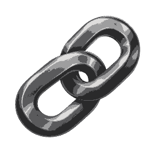

# Overlink

Connect an AI assistant to the Windows computers you work on.

Overlink gives ChatGPT tools to inspect projects, edit files, run checks, work with a browser and use supported desktop applications on paired computers. Results return to the conversation, so the next step can be based on what actually happened on the machine.

The aim is to keep the request, the work on the computer and the returned result in one workflow.

**Status:** private development project. It has been used in a personal setup with two Windows computers. Wider deployment, reliability across different machines and longer autonomous workflows remain development work.

## What it can do

| Area | Available tools |
|---|---|
| Projects and coding | Read project structure and source, search code, inspect Git changes, apply guarded edits and run selected tests or builds. |
| Files and commands | Read and write files and run commands on a selected, authorized computer. |
| Browser and desktop | Inspect browser pages and Windows controls, interact with them and capture a screenshot when visual context is needed. |
| Web extraction | Extract named fields from rendered pages, follow bounded pagination and retain partial crawl results. |
| Local applications | Use configured adapters for Obsidian, GitHub, VS Code and Blender. |
| Work across computers | Transfer selected information or small files between paired devices and keep task checkpoints for later continuation. |

Availability depends on the computer being online, its enabled capabilities and the required application being installed and configured.

## How it works

| Part | Responsibility |
|---|---|
| ChatGPT and its tool connection | Interpret the request, choose tools and inspect returned results. |
| Overlink relay | Route a request to the selected paired computer and return job status or output. |
| Windows launcher and local tools | Execute the supported operation under the configured permissions and approval settings. |

A coding workflow can read a project's files and current hashes, apply a targeted edit, run the project's checks and return the output for review. The editing tools use file-hash preconditions and backups; pending jobs are polled by ID instead of submitted again.

The AI model runs through its chat provider. Overlink supplies local tools, job records and checkpoints for continuing work.

## Repository and access

This repository contains the public overview and logo. The application implementation is private; this repository has no installer or runnable server.

A demo and a technical walkthrough are available on request. The walkthrough can cover a real task, the tools it calls, the results it returns and the current limitations.

**Built by [Issa Alexandre Tagro](https://github.com/useralx01).** For a demo, an AI integration role or a paid project: [dretagro@gmail.com](mailto:dretagro@gmail.com).
